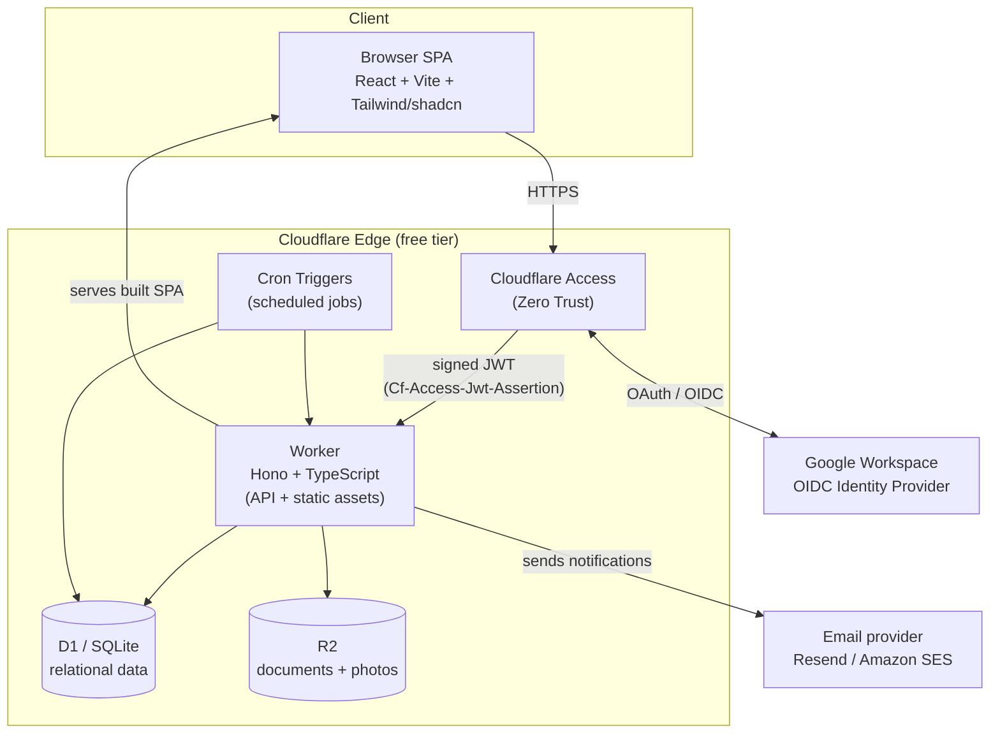

# Internal HRMS on Cloudflare — Build Plan

A blueprint for an internal Human Resource Management System, authenticated through Google and hosted entirely on Cloudflare's **free** tier, with the honest caveats about where the free tier runs out.

> This is the design rationale (stack, free-tier analysis, payroll scope, Clean-Architecture stance). The
> authoritative design for **access control** is in **`docs/authz.md`**.

---

## 1. Executive summary

The recommended stack is **TypeScript on Cloudflare Workers** (V8-native, not WASM), serving a **React SPA** as static assets from the same Worker, with **Hono** as the API framework, **D1 (SQLite)** as the relational database, **R2** for documents, **D1** plus a small in-isolate cache for config and reference data, and **Google** for authentication (through Cloudflare Access, or the Worker's own OIDC flow — §4; this deployment runs the latter). Background work runs on **Cron Triggers**. Transactional email is the one piece that lives off Cloudflare (Resend or Amazon SES).

Three decisions deserve emphasis up front:

- **Pick TypeScript, not a WASM language.** An HRMS is mostly forms, workflows, role-based access, and reporting — CRUD with strict authorization. TypeScript on Workers gives you the mature ecosystem (Hono, Drizzle, Zod, `jose`) and the fastest path for a team to maintain. Rust→WASM (`workers-rs`) buys correctness and raw speed you don't need here, at the cost of slower iteration and a thinner web-framework ecosystem. Reach for WASM only for a specific hot path later (e.g. heavy PDF/report generation or crypto) — and most teams never need to.
- **The free tier is genuinely enough to compute and store an HRMS for a small/medium org, but it has hard edges.** The two that will bite you: Cloudflare Access is free for **50 users**, and **there is no first-party free transactional email**. The plan below is designed around these limits rather than into them.
- **Use a light Clean Architecture, not the full ceremony.** Keep Robert C. Martin's Dependency Rule — business logic never imports Hono or Drizzle — so the rule-heavy core (leave accrual, approvals, RBAC) stays unit-testable in isolation. But skip the apparatus aimed at swapping the database or framework: this app is deliberately welded to Cloudflare, and the plain-CRUD surface stays thin. See §8.
- **The API is strictly resource-oriented (aep.dev), OpenAPI-first.** `openapi.yaml` (OpenAPI 3.1) is the source of truth, linted by the official `@aep_dev/aep-openapi-linter` (a Spectral ruleset) in CI. Resources expose `path`/`create_time`/`update_time`/`etag` (the `path` id is an opaque encrypted token); wire fields are snake_case; collections are kebab-case under `/v1`; List is paginated; Update is JSON Merge Patch; errors are RFC 9457 problem details; async work returns a 202 Operation. **The full, binding rules live in `01-aep-guidelines.md` — read it before writing any route.** AEP shapes the wire contract only; the Drizzle storage model is unchanged and mapped to resources in a serializer (§8).

---

## 2. Recommended technology stack

| Concern | Choice | Why this, on the free tier |
|---|---|---|
| Compute | **Cloudflare Workers** (free: ~100k req/day) | Serverless, global, zero ops. Serves both API and the built SPA from one deployable. |
| Language | **TypeScript** (V8-native) | Best DX + ecosystem for CRUD/workflow apps; type safety end-to-end with the DB and validation layers. |
| API framework | **Hono** | The de-facto Workers framework: tiny, fast, first-class TS, built-in middleware (CORS, JWT, validation). |
| API design | **AEP (aep.dev), OpenAPI 3.1** | Strict resource-oriented design; `openapi.yaml` is the source of truth, linted by the official `@aep_dev/aep-openapi-linter`. Rules in `01-aep-guidelines.md`. |
| Frontend | **React + Vite + TypeScript**, **Tailwind** + **shadcn/ui** | Fast to build internal dashboards; shadcn/ui gives a professional look without a design team. |
| Charts | **frappe-charts**, lazy-loaded, behind one `Chart` component | MIT, no runtime dependencies, plain SVG, ~18 KB gzipped in a chunk only a page that draws something fetches. Every chart in the app goes through `web/src/components/common/Chart.tsx` (framed by `ChartCard`), which owns the palette (`lib/chartTheme.ts`), the dark-mode rebuild, the reduced-motion opt-out and the screen-reader data table. **No page hand-draws a chart**: the cumulative flow diagram, the sprint burndown, the velocity bars and the daily-hours strip were each a private SVG with its own scale, axis and theme block, and all four are now this one component. What stays hand-drawn is what is not a chart - a progress ring, a percentage bar, the attendance month grid: no axis, no series, and a charting engine would make them bigger and worse. **Page order is fixed: charts, then metrics, then the list.** The `SummaryStrip` / `StatCard` / `StatTile` row is the table's filter surface - every metric narrows the rows under it - so it rides directly on top of the table it filters, with the charts above it; put the charts between the strip and the table and they push the page's filters a screen away from the thing they filter. Where a metric filters nothing on the page (`RecruitingAnalytics`, whose tiles navigate to other pages; a Boards analytics tab with no list under it) the strip leads instead. **A chart is also a filter.** Pressing a bar, a point or a slice narrows the list under it to the rows that mark counted, pressing it again clears, and the pick is in the URL query (`?slice=<dimension>:<key>`) so a narrowed page is shareable and the back button undoes it - `lib/chartFocus.ts`, the chart-side twin of `lib/kpiFocus.ts`'s `?focus=`. The press is resolved out of the SVG by `Chart.tsx` rather than through frappe's `data-select`, which only axis charts fire, refuses to fire twice for the same point (so a filter could never be toggled off) and is driven by a document-wide keydown listener that outlives the chart that added it; frappe's `isNavigable` is therefore off everywhere. A chart that filters nothing says why in a comment and is named in `e2e/chartDrill.spec.ts`'s exemption list, which fails on any new chart that is neither. |
| Routing | **Own history router** (`web/src/router.ts`, ~250 lines, no dependency) | Routes are real paths (`/employees/<id>/documents`), so a copied link, a crawler and a fresh tab all resolve the same URL, and the address bar carries no `#`. The app's needs are a parse, a guard and a scroll rule, all of which a library would still leave to be written; what it buys instead is one route-change event that `pushState` and `popstate` both feed, which is what lets the unsaved-changes guard, the scroll manager and `useRoute` agree on ordering. The cost is a server contract: any path the Worker does not own must answer with the app shell, which is `app.notFound` in `src/index.ts` and why `not_found_handling` is `"none"`. In-app links stay plain `<a href="/…">`; one delegated click listener in the router turns them into route changes. |
| Frontend hosting | **Workers Static Assets** (built SPA served by the same Worker) | One deploy, one domain, no CORS. (Cloudflare Pages is an equally valid alternative if you prefer split frontend/backend deploys.) |
| Relational DB | **Cloudflare D1** (SQLite) | The native relational store on Cloudflare. Perfect for the relational shape of HR data. Free: ~5 GB, 5M row reads/day, 100k row writes/day. |
| ORM / queries | **Drizzle ORM** (+ `drizzle-kit` migrations) | Type-safe, lightweight, excellent D1 support, SQL-first. (Kysely is a fine alternative.) |
| Validation | **Zod** (+ `@hono/zod-validator`) | One schema for request validation and TS types. |
| Object storage | **Cloudflare R2** | Employee documents, contracts, ID scans, payslip PDFs, profile photos. Free: 10 GB, **zero egress fees**. |
| Config / cache | **D1** + a short-TTL **in-isolate cache** | App config, feature flags, and reference data (holiday calendar, departments) live in D1; cache read-mostly lookups in Worker memory. |
| Auth (identity) | **Cloudflare Access (Zero Trust) + Google as IdP** | Offloads the entire Google OAuth dance to the edge; injects a signed JWT into every request. Free for 50 users. |
| Authorization | **Policy-as-data in D1, enforced in one middleware** | Roles, grants, per-object exceptions + manifest are data (`roles`/`grants`/`policy`, compiled to an `access_rules` table); the `authz` middleware is the single gate (fail-closed; the DB narrows by exact code, the tested engine decides; role rules cached per role). Editable at runtime via management endpoints (roles/grants/policy/grant-exceptions). Cloudflare authenticates; *you* authorize. See `docs/authz.md`. |
| Background jobs | **Cron Triggers** + a D1 `jobs` table | Leave accrual, reminders, document-expiry checks, report snapshots. (Cloudflare Queues are **paid** — avoid on free tier.) |
| Email | **Resend** or **Amazon SES** (off-Cloudflare) | No free first-party transactional send. Resend's free tier (~3k/mo) suits a small org; SES for volume. |
| Local dev / deploy | **Wrangler** + **Miniflare/workerd** | Local D1/R2 emulation, `wrangler dev`. |
| CI/CD | **Workers Builds** (Git integration) or **GitHub Actions** + `wrangler-action` | Per-PR preview deployments, free. |
| Testing | **Vitest** + `@cloudflare/vitest-pool-workers` | Runs tests against the real workerd runtime with live D1/R2 bindings. |
| Secrets | **Worker Secrets** (`wrangler secret put`), `.dev.vars` locally | Google client secret, JWT signing key, email API key, field-encryption key. |
| Backups | **D1 Time Travel** (30-day PITR) + scheduled `wrangler d1 export` → R2 | Free point-in-time recovery plus long-term archive. |
| CAPTCHA (if needed) | **Turnstile** | Free; only relevant if you ever expose a public form. |

**Optional / phase-later Cloudflare pieces:** Durable Objects (SQLite-backed DOs are now available on the free plan, with limits — useful for atomic counters, rate limiting, or real-time presence, but not needed for an MVP), Workers AI + Vectorize (a future HR-policy search or assistant), and Workflows (durable multi-step processes — check current free allocation before relying on it).

---

## 3. Architecture



**Request flow:** the browser hits the app hostname → Cloudflare Access intercepts, requires Google login (first visit), and thereafter forwards every request with a signed JWT → the Worker validates that JWT, maps the verified email to a user + role in D1, and serves either the SPA shell or a JSON API response. Documents are read/written through the Worker (so authorization is enforced) against R2; reference data and config come from D1 (cached in the Worker isolate); scheduled work (accruals, reminders) runs on Cron Triggers against D1 and sends mail via the external provider.

**Why a single Worker serving both API and assets:** one domain (no CORS), one deploy, one place for auth middleware, and it keeps you comfortably inside the free request budget. If your team prefers a hard frontend/backend split, host the SPA on Cloudflare Pages and the API on a separate Worker — the rest of the design is unchanged.

---

## 4. Authentication — "offload to Google"

There are two clean ways to do this on Cloudflare, and **both are implemented**: configuration picks one at
runtime. Access mode is the default; setting `GOOGLE_CLIENT_ID` selects Google mode. This deployment runs
**Path B (Google mode)**, because per-seat Access pricing above 50 users is the one cost the free-tier
design could not absorb. Operational setup for the live path is `docs/deploy.md` §3; the runtime contract
is `src/routes/authRoutes.ts` + `src/middleware/auth.ts`.

### Path A — Cloudflare Access + Google (implemented; default when `GOOGLE_CLIENT_ID` is unset)

You write **no OAuth code at all**. Cloudflare handles the Google login, MFA, device posture, and audit logging; you just trust and verify a JWT.

Setup:
1. In **Zero Trust → Settings → Authentication**, add **Google** (or **Google Workspace**) as a login method using an OAuth client from Google Cloud Console.
2. Create a **self-hosted Access application** covering your app's hostname.
3. Add an **Access policy** that allows only `emails ending in @yourcompany.com` (or specific Google groups). This is your first gate — non-employees never reach the Worker.
4. On every request Cloudflare adds the header **`Cf-Access-Jwt-Assertion`** (and a `CF_Authorization` cookie).

In the Worker, validate that JWT on each request:
- Fetch the JWKS from `https://<your-team>.cloudflareaccess.com/cdn-cgi/access/certs`.
- Verify the signature, the `aud` (your Application Audience tag), `iss`, and `exp` using `jose`.
- Read `email` / `sub` from the claims and look up the user + role in D1 (auto-provision on first login if you like).

Trade-off: the free Zero Trust plan covers **50 users**. Beyond that it becomes a paid per-seat plan, at which point Path B may be cheaper.

### Path B — Google OIDC inside the Worker (implemented; the live path here)

Implement the standard **Authorization Code + PKCE** flow with Hono routes:
- `GET /auth/login` → redirect to Google's authorize endpoint with `scope=openid email profile`, a `state`, PKCE challenge, and an `hd=yourcompany.com` hint.
- `GET /auth/callback` → exchange the code for tokens, verify the **ID token** against Google's JWKS, and **enforce the email domain** (`hd` / verified email) server-side. Then establish your app session.

**Session strategy on the free tier (important):** use a **stateless signed JWT** in an `HttpOnly; Secure; SameSite=Lax` cookie (sign with a key from Worker Secrets, short expiry + refresh), signed/verified with `jose`. This avoids a per-request session write entirely. If you need revocation, keep a *small* deny-list in a D1 table (low write volume). Protect state-changing requests with a CSRF token (double-submit) in addition to `SameSite`.

**As built:** the session cookie is a stateless HMAC-signed token (`src/lib/session.ts`, `AUTH_SESSION_KEY`,
12h TTL) with the nonce tying the id token to the browser that started the login; CSRF is a required
`X-Requested-By` header on every mutation; `ALLOWED_EMAIL_DOMAINS` is the fail-closed org perimeter, and
`makeDeps` refuses to boot Google mode without it. Revocation is not a deny-list: `auth.ts` re-reads the
user row and its grant on every request, so disabling a user or changing their role takes effect on the
next call.

> Whichever path you choose, Cloudflare/Google only tell you **who** the user is. **What** they can see and do is your application's job — see §7.

---

## 5. Data model & modules

HR data is relational, which is exactly what D1/SQLite is good at. Core entities:

- **`users`** — links a verified Google email → internal user; `role`, `status`, `employee_id`.
- **`employees`** — personal details, contact info, emergency contact, job title, manager_id (self-referential for reporting lines), start/end dates.
- **`departments` / `teams` / `positions`** — org structure.
- **`roles` / `permissions`** — RBAC (or encode roles as an enum + a permission matrix in code).
- **`leave_types`, `leave_balances`, `leave_requests`, `holidays`, `holiday_selections`, `comp_off_credits`** — time-off engine and company calendar. A holiday may be scoped to a work location (matched against the employee's current `positions.location`) and may be a half day; `comp_off_credits` is the per-(employee, day) marker that makes the nightly comp-off credit for holiday work idempotent. A leave type also carries a `restrictions` policy blob — notice requirements, quotas, combinations, the sandwich rule, exit-process limits, joining-month cutoffs — layered over the org-wide baseline in `settings/leave_restrictions` and evaluated by the pure rules in `src/domain/leaveRestrictions.ts`, which the SPA imports so the dialog and the server enforce one rule set. Both scopes are edited through one component (`web/src/components/leave/RestrictionsEditor.tsx`): every rule states which of the three things it is doing — following the org, setting its own value, or opting out of the org's — through one segmented control, and the editor mirrors `validateRestrictions` as it is typed so a policy the server would refuse is refused before Save.
- **`org_documents`** / **`personal_documents`** — metadata + R2 object key, type (contract, ID, payslip, policy), expiry date. Company-wide docs use a flat code; employee-owned docs an owner-embedded code; access is the middleware's code-scoped grant.
- **`announcements`** — company-wide posts.
- **`audit_log`** — append-only record of who viewed/changed what, when.
- **`jobs`** — queue table processed by cron (since Queues are paid).
- **`compensation`** — effective-dated salary records per employee (annual CTC, its derived basic/allowance split, currency, pay grade). One contiguous timeline of half-open intervals per employee, with at most one open (current) row. A revision may be added at any effective date — including inside the existing history — corrected in place, or removed (soft; the preceding revision absorbs its window and reopens if it was the current one). Removal is refused once the revision's retro arrears have been paid out. Every one of those writes carries a before/after in `audit_log`, which is what preserves the history — not a refusal to write.
- **`pay_components`** — definitions of earnings and deductions (fixed amount or a simple formula like % of base or rate × quantity; recurring or one-time).
- **`pay_periods`** — the pay calendar (e.g. monthly cycles with cut-off and pay dates).
- **`payroll_runs`** — one per pay period; carries the run's state (draft → review → approved → locked → published) and becomes immutable once locked.
- **`payroll_run_items`** — per-employee line items for a run (each earning/deduction, gross, total deductions, net); frozen when the run locks.
- **`payslips`** — metadata + R2 object key, linked to a run item.

Suggested module/roadmap grouping:

1. **Employee directory & profiles** — search, view, edit (scoped by role); documents in R2.
2. **Org structure** — departments, teams, reporting lines, an org chart view.
3. **Time off** — leave types, balances, **accrual via cron**, request → approval workflow, holiday calendar, email notifications.
4. **Onboarding / offboarding** — checklists and task assignments.
5. **Announcements & company directory.**
6. **Reporting & exports** — headcount, leave usage, anniversaries, payroll registers and cost-to-company; CSV export (generate large reports in a cron job, not in a live request).
7. **Payroll — compensation & payslips** — salary structures and pay components, effective-dated compensation history, and a payroll-run workflow (draft → review → approve → lock → publish) that totals earnings and deductions — including loss-of-pay pulled from the leave module — into gross and net. The `:publish` step is a **long-running operation**: it returns a 202 with an AEP Operation (the `jobs` row), and a cron-drained, resumable job generates the payslip PDFs into R2 with a pure-JS library (e.g. pdf-lib, which runs in Workers without native binaries) in idempotent batches; clients poll `/v1/operations/{operation}` for completion. (Full headless-browser rendering is a separate paid Cloudflare product.) Employees reach their finished payslips through self-service.

   The payslip **layout is configuration, not code**: the `payslip` settings blob holds one org-wide design as an
   ordered list of blocks (company header, identity row, detail grid, attendance strip, earnings/deductions,
   net-pay box, notes, dividers, footer), validated on save against a closed vocabulary
   (`src/domain/payslipTemplate.ts`) and walked by the renderer (`src/lib/pdf.ts`). Three layers of control:
   document options (typeface, page size, margin, text scale, accent/ink/secondary/line colours), a `style`
   available on every block (size, colour, weight, alignment, space above/below), and per-block structure (logo
   size and side, grid label casing/size/row pitch, earnings-column split, zebra striping, row lines, net-box
   fill and border, which attendance figures appear). Everything unset inherits the stock design, so an untouched
   template renders exactly as it always did - pinned by a geometry tripwire in `test/payslipTemplate.test.ts`. HR edits it in
   Settings → Payslip design against a sample-data preview (`payslips:previewTemplate`), and checks real figures
   before publishing with `payroll-runs/{id}:previewPayslip`. A closed block vocabulary rather than HTML because
   generation happens in the Worker with no DOM to lay markup out; an edit affects future runs only, since a
   published payslip's PDF is already frozen in R2.
8. **Performance (phase 2)** — reviews, goals/OKRs, feedback. A goal names the review cycle it was set for
   (`goals.cycle_id`), and that link — not a date guess — decides which goals a review scores. Enrolling
   someone in a cycle claims their unattached, open, in-window goals once, explicitly and audibly in the audit
   trail, so the inference happens at a moment a person chose rather than on every render. The review then
   carries the goals it scores (`review.goals`), the weighted attainment over them
   (`sum(weight × progress) / sum(weight)`, cancelled goals excluded — `domain/performance.ts`), and the
   manager's per-goal verdict keyed by goal code. Sharing a review **freezes** the goal list into
   `reviews.goals_json`: a review is a record of a moment, and re-deriving last year's attainment from this
   year's progress would rewrite history. The live (unshared) read is bound to the reader's own `goals` scope,
   so seeing someone's review is not by itself entitlement to their objectives; the frozen snapshot is exempt,
   being part of the review the reader is already allowed to read.
   **Goal health is derived, never stored** (`domain/goals.ts`): `expected_progress` is a straight line from
   the goal being set to its due date, `drift` is progress against it, `pace` bands that drift, and
   `stale_days` counts the silence since the last write, progress move or comment. The serializer computes all
   four so there is one implementation and the browser renders the answer. A goal with no honest answer emits
   no fields at all - undated, completed, cancelled and back-dated goals report no pace, rather than a drift
   of 0 that reads as healthy. `confidence` is the one stored half: the owner's forward-looking call, set
   through the narrow `:setConfidence` verb (progress-only rights are enough - admitting a goal is slipping
   must not require rights to rewrite it), and the disagreement between it and `drift` is the point. Progress
   history and the cycle burn-up are read back out of `audit_log`, which has recorded every progress move
   since the feature shipped; a progress-history table would be a second copy of the audit trail that could
   disagree with it.
   **Goals are agreed, not just typed** (`goals.stage`: DRAFT → PROPOSED → AGREED, moved by `:propose`,
   `:approve`, `:requestChanges`). A review scores people against their goals, so the record has to be able to
   say whether the scorer ever accepted them - `agreed_at`/`agreed_by` stamp that, and a goal that reaches a
   review un-agreed is marked as such in the panel and the snapshot. The handshake is off by default
   (`settings/performance` `goal_approval`), because in most orgs setting a goal is agreeing it; when it is on,
   only a goal somebody writes for THEMSELVES needs submitting - a manager writing one for a report is already
   the approver. A rejection's reason is posted as a comment on the goal rather than into a field of its own,
   so the reply lands in the thread the goal already has. The cycle's own `goal_setting_due_date` turns the
   coverage gap into a countdown.
9. **Attendance / assets (optional)** — timesheets, laptop/equipment tracking.

**Payroll scope — what's in, and what's deliberately out.** This build includes **compensation management and payslips** for a single jurisdiction: salary structures, pay components, comp history, the payroll-run workflow, payslip generation, and self-service access. It deliberately leaves out three risky slices, which stay outside the app (integrate or human-gate them instead):

- **Gross-to-net statutory calculation** (income tax/withholding, social security). The app records and displays statutory deduction *amounts* as line items, but those figures come from outside the system — it does not derive them. If you ever add this, build it as **versioned, effective-dated tax config** in the pure domain layer, exhaustively tested against known-correct figures and validated by a payroll professional on every change — never hard-coded rates.
- **Payment disbursement.** No money movement. Export a bank-ready bulk-transfer file, or hand off to a payments provider.
- **Statutory filing.** Generate the data, but route the actual filing through an accountant or a compliance service.

In short, the app does ordinary compensation arithmetic — summing earnings and deductions into gross and net — but not statutory tax logic, and it never moves money or files with authorities.

---

## 6. Free-tier limits & the gotchas to design around

Numbers change — **verify the current limits in the Cloudflare dashboard before you commit** — but as of planning these are the edges that matter:

| Service | Free allowance (verify) | What it means for an HRMS |
|---|---|---|
| **Workers** | ~100,000 requests/day; limited CPU time per request | Plenty for an internal app of dozens–low hundreds of users. **Count API calls per page** in the SPA, and keep handlers lean — offload heavy compute (big reports) to cron. |
| **D1** | ~5 GB, 5M row reads/day, 100k row writes/day | Comfortable for HR data. Watch **bulk imports** (initial employee load) against the daily write cap — batch over time if large. |
| **R2** | 10 GB, ~1M Class A + ~10M Class B ops/mo, **free egress** | Tens of thousands of documents fit easily. |
| **Cloudflare Access** | **50 users** | Fine for small/medium orgs; beyond that, pay per seat or switch to DIY OIDC (Path B). |
| **Cron Triggers** | available (small number of crons) | Enough for nightly accrual + a few reminder jobs. |
| **Queues** | **Paid only** | Don't use. Model async work as a D1 `jobs` table drained by cron. |
| **Durable Objects** | SQLite-backed DOs on free (with limits); classic DOs paid | Optional. Use sparingly for counters/rate-limiting if ever needed. |
| **Email (transactional)** | **None first-party** | Use Resend (~3k/mo free) or Amazon SES. Cloudflare Email Routing is inbound-forwarding only. |

**Rules of thumb that fall out of the above:** stateless JWT sessions (no per-request datastore write); batch any bulk write; never block a request on heavy work; treat email as an external dependency from day one.

### 6.1 The read budget

D1 bills **rows read** and Workers bill **requests**, so "what does one page cost" is an architectural question, not a tuning detail. Five mechanisms answer it, each at the layer where the waste actually happened:

| Layer | Mechanism | What it stops |
|---|---|---|
| Client transport | GET coalescer (`web/src/lib/getCoalescer.ts`) | Many reads becoming many HTTP requests: they collapse into one `POST /v1/batch:run`, and identical in-flight paths share a promise. The window is TRAILING (each read extends it, capped from the first), because a page mounts in waves - shell, then page chunk, then tabs - and a fixed window split them into several small batches. |
| Client cache | Resource store (`web/src/lib/resourceStore.ts`) over the record store (`web/src/lib/clientStore.ts`) | Re-reading the same collection per component, per navigation, per reload. Three freshness tiers - reference catalogs for minutes, the employee directory in between, anything transactional at 20s - govern reuse *within* a page life; a lapsed window is revalidated CONDITIONALLY (`src/http/listEtag.ts`), so being told nothing changed costs one indexed row rather than a page of them. ACROSS page loads the rows are kept in IndexedDB, namespaced to the identity the app is answering as, held to a per-class budget, and hydrated once at boot; the change feed below decides which stored copies survive. Money and identity collections are cached in memory only and never written down. A write invalidates the collection everywhere, including the stored copy and sibling tabs; signing out purges the lot. |
| Reconciliation | `GET /v1/changes` + `collection_versions` triggers | Revalidating what nobody edited. A stored copy used to be worth only a faster paint: whatever its tier said, the next page load found it lapsed and re-read it, so a reload cost a read per collection on screen to discover almost nothing had changed. One request now answers that for everything at once, and only the collections it names are re-read. The stamps come from generated triggers (`src/db/changeDdl.ts`), not the audit log, *because* the audit log is incomplete - cron accrual, the automation engine, the code cascade and the notification writer all write without an audit row, and a missed write here is not a stale badge but a client serving yesterday's rows forever. The settings snapshot and the approvals badge ride the same signal. |
| Client singletons | Settings (`lib/settingsStore.ts`), preferences (`lib/prefs.ts`) | One request per config blob. Each is read whole, once, and shared: `settings` for every org blob a page consults (and kept on disk, because config GATES other reads - the dashboard cannot ask for its KPI counts until it knows which cards the viewer sees; a stored copy is served only once the change feed has vouched for it, because a config read is awaited once and there is no later render to correct), `preferences` for theme + tab-seen + table columns + dashboard layout (written back on a coalescing window, since the tab-seen map moves on every navigation), Faces are not on this list: an avatar is an `` at `GET /v1/employees/<id>:getPhoto?v=<version>`, so the browser's own cache keeps it and a replaced photo is a different URL. The app carried a cache for them once - batched fetches, base64 payloads, a disk layer - and now carries none. |
| Server aggregates | `dashboard-summary`, `people-analytics`, `approvals-summary`, `activity-counts`, `search` | Reading whole collections to compute a number. Each is a gated fan-out that returns counts, never rows (see docs/authz.md §12.1.1). `people-analytics` is the widest of them - one row per person over eight collections, which as a client-side job would mean fetching every one of those collections in full and computing punctuality in the browser, and would still be wrong past the first 100-row page. `activity-counts` was the worst offender: the workspace tab bar counted "new since you last looked" by FETCHING every sibling tab's collection, so `/boards` read boards + goals + reviews + check-ins on every navigation to render four small numbers. |
| Read on sight | Section probes (`web/src/hooks/useInView.ts`) + per-widget gates | Fetching what is not on screen. A dashboard section's collections are read when its slot reaches the viewport - and every region already visible is reported in ONE observer callback, so their reads share a single batch. Elsewhere the same rule is applied by hand: a label list waits for a row that references it, a picker waits for its dialog, a detail page reads ONE record by id (`hooks/useResource.ts`) rather than filtering a page of rows it also had to fetch. |
| Server per-request | Reference memo (`src/lib/refData.ts`), policy cache (`src/lib/cache.ts`) | The same small catalog scanned repeatedly inside one operation - a payroll build read `pay_components` three times - and the authority rows re-read per decision. The catalogs are memoized for exactly ONE request (they price money; nothing may outlive the caller's own call); the read-mostly authority rows are cached per isolate with a short TTL and busted on write. |

A count can also decide whether rows are worth reading at all: outside the inbox, the approvals provider reads only the queues whose count is non-zero, so an org with two live requests reads two collections rather than ten (and the dashboard's first batch stays under the 20-sub-request cap instead of spilling into a second one).

Gates keep this from rotting: `test/webReadDiscipline.test.ts` fails a per-key settings read, an unshared collection read, or a tab badge that fetches a collection; `test/webApprovalQueues.test.ts` fails a page that renders an approval queue the route didn't ask for; `test/getCoalescer.test.ts` pins the window shape (adjacent waves merge; the cap holds; a dependent read is never waited for); `test/changeDdlDrift.test.ts` fails a collection with no change-stamp trigger, because a collection that never reports a change is one whose stored copy is never given up; and `test/resourceStoreCache.test.ts` pins what the store does with a stored copy in each answer the feed can give - kept when nothing changed, re-read when named, given up when the feed cannot answer or fails.

One thing is deliberately NOT cached across page loads: `GET /users/me`. Everything else is namespaced by the identity it answers as, and that identity comes from this request - serving it from a stored copy would mean choosing the cache namespace, and the shell, from a guess, and Cloudflare Access can change who is signed in without the SPA being told.

---

## 7. Security & compliance (treat this as first-class)

An HRMS holds some of the most sensitive data an org has — salaries, national IDs, bank details, performance notes, leave that can imply medical info. The free tier handles compute and storage fine; the *serious* work is here.

- **Authorization (single source, policy-as-data).** Roles are *data* in D1 (seeds: `employee` self-only, `manager` self + dept, `hr_admin` all employee data, `payroll_admin` compensation/runs - kept separate from `hr_admin` so salary stays need-to-know, `super_admin` config/roles). Authority is compiled to an `access_rules` table; the **`authz` middleware is the only place an access decision is made** - it reads the caller's role grant (reconstructed from `access_rules`, cached per role) plus any per-object exceptions (narrowed by exact ancestor-code `IN`), resolves the request's hierarchical `code`, and the tested engine decides and blocks on deny. The DB only narrows by exact code (never a SQL prefix); the engine is the sole authority. Services/routes hold **no** checks; list breadth is computed in the middleware and merely *applied* by the service (`applyScope`). Policy is editable at runtime via the management endpoints (roles/grants/policy/grant-exceptions), super-only by grant data. Everything is private by default and fail-closed. Never trust the client; the SPA hiding a button is not security. Full design: `docs/authz.md`.
- **Field-level encryption** for the most sensitive columns (bank details, national ID, and salary if you choose). Encrypt before storing in D1 using a key from Worker Secrets (envelope-encryption pattern), so a DB export alone doesn't leak them.
- **Payroll controls.** Treat compensation as the most restricted data in the system: keep `payroll_admin` separate from `hr_admin`, restrict **approval to `super_admin`** (a grant `deny` on `:approve` for everyone else, expressed as policy data), make a **locked payroll run immutable** (corrections become new adjusting entries, never edits to a published run), and audit every compensation change and run-state transition.
- **Encryption in transit & at rest.** TLS is automatic at the edge; D1 and R2 are encrypted at rest by Cloudflare. Field encryption (above) adds defense in depth for the crown jewels.
- **Audit logging.** Append-only `audit_log` for views and changes of sensitive records; periodically export to R2 for retention. Important for compliance and incident response.
- **Input validation & output encoding** via Zod everywhere; **CSRF protection** for cookie-based mutating requests; **rate limiting** via Cloudflare rules (or a Durable Object) on auth and write endpoints.
- **Data residency & privacy.** Map your obligations (GDPR/CCPA/local law): right to access and erasure, retention schedules, and where data physically sits. R2 supports **jurisdictional restrictions** (e.g. EU) if residency matters.
- **Least privilege & supply chain.** Minimal Worker Secrets scope, dependency scanning (e.g. Dependabot), pinned versions.
- **Backups & recovery.** Rely on **D1 Time Travel** (30-day point-in-time restore) plus a scheduled `wrangler d1 export` to R2 for longer-term archives.

> Because of the data involved, have someone responsible for privacy/compliance review the design and your data-retention policy before go-live. This plan covers the engineering controls; it is not legal advice.

---

## 8. Code organization & architecture style

Adopt a **light Clean Architecture** — the principle, not the full ceremony. The rule worth keeping is Robert C. Martin's **Dependency Rule**: source dependencies point inward, so business logic never imports Hono, Drizzle, or the Cloudflare bindings. That single discipline gives the real payoff — a core you can unit-test without spinning up workerd or D1, with platform coupling confined to the edges. The rule-heavy parts of an HRMS (leave accrual, proration and carry-over, approval and payroll-run state machines, RBAC/eligibility, payroll gross/net totals) carry logic worth testing in isolation, and they change for business reasons unrelated to the database or UI.

What to deliberately **skip**: the apparatus aimed at swapping the framework or database. This app is welded to Cloudflare — D1, R2, Workers, Access — and you won't replace D1 (single-region edge SQLite) with Postgres without re-architecting, so a hand-rolled repository interface per table guards against an event that won't happen while costing indirection every day. Drizzle is already a reasonable abstraction over SQL; don't wrap it again. Keep the plain-CRUD surface (employee directory, departments, documents) **thin** — map straight from request to query to response. Add a port (interface) only where there's a genuine seam, and in TypeScript express it with plain functions and a small typed `Deps` object passed in, not a DI framework.

The layers, outermost to innermost:

- **domain** — pure types and rule functions (accrual math, balance changes, approval transitions, permission checks, payroll earning/deduction totals). No framework or DB imports.
- **services** (use cases) — orchestrate the domain and call ports, e.g. `requestLeave(deps, input)`.
- **routes** (interface adapters) — validate with Zod, call a service, format the response. They never pass `Context` or `Request` inward. As built, most of this layer is *declarative*: `http/collectionRoute.ts` + `services/crud.ts` generate the AEP standard-method lane from a per-collection spec, so a route file states only what is specific to its collection (see `docs/03-add-a-resource.md`).
- **db / lib** (adapters) — Drizzle/D1, R2, and the email client live here, behind the boundary.

The repository layout reflects these layers:

```
hrms/
├─ wrangler.toml            # bindings: D1, R2, assets, cron, secrets
├─ drizzle.config.ts
├─ vitest.config.ts
├─ package.json
├─ .spectral.yaml           # extends the official @aep_dev/aep-openapi-linter ruleset
├─ openapi.yaml             # OpenAPI 3.1 — SOURCE OF TRUTH for the API
├─ src/                     # the Worker (Hono API; the built SPA is served as static assets)
│  ├─ index.ts              # app entry: middleware chain + /v1 routing; scheduled() for cron
│  ├─ env.ts                # Bindings, AppUser, AppEnv types
│  ├─ deps.ts               # makeDeps(): builds the per-request Deps (db + ports)
│  ├─ cron.ts               # scheduled handlers (job drain, accrual, reminders)
│  ├─ domain/               # PURE rule functions (no framework/DB imports)
│  │  ├─ payroll.ts         #   payroll totals + run state machine (verified)
│  │  ├─ leave.ts           #   working-day / accrual math
│  │  ├─ permissions.ts     #   authz engine: path matcher + read<write<admin ladder + deny-wins
│  │  ├─ codes.ts           #   hierarchical scope codes (compose/parse/boundary match)
│  │  ├─ access.ts          #   list-scope (all/dept/own) from the grant
│  │  └─ grants.ts / manifests.ts  #   TYPED POLICY DEFAULTS (seed only; runtime policy is DB data)
│  ├─ services/             # use cases: orchestrate domain, call ports + DB, write audit
│  │  ├─ employees.ts  departments.ts  leaveRequests.ts  payroll.ts
│  ├─ routes/               # one file per collection: a spec on collectionRoutes(), or a bespoke handler
│  │  ├─ employees.ts  departments.ts  leaveRequests.ts  payrollRuns.ts
│  │  ├─ operations.ts      #   AEP-151 LRO poll endpoints (/v1/operations[, /{operation}])
│  │  └─ users.ts           #   users resource; caller identity via the `me` self-alias (GET /v1/users/me)
│  ├─ http/                 # the AEP wire boundary
│  │  ├─ collectionRoute.ts #   the ONE standard-method lane every collection is generated from
│  │  ├─ serialize.ts       #   row -> AEP resource (path, snake_case, etag); omits *Enc
│  │  └─ pagination.ts      #   opaque cursor + page-size clamp
│  ├─ ports/                # interfaces for real seams: Encryptor, EmailSender, DocumentStore, Clock
│  │  └─ index.ts
│  ├─ middleware/           # auth (Access JWT / session cookie / API key + grant/policy ride-along), authz (single gate),
│  │                        #   encodeWireIds/decodeWireIds (opaque ids), csrf, dbContext, errorHandler (RFC 9457)
│  ├─ lib/                  # adapters: crypto (field encryption), email, docstore (R2), cache, audit, pdf, errors
│  └─ db/
│     ├─ schema.ts          # Drizzle schema (persistence model)
│     └─ migrations/        # drizzle-kit migrations
├─ web/                     # React SPA (Vite); api.ts, useMe.ts, App + pages
│  └─ dist/                 # build output -> served by the Worker via Static Assets
└─ test/                    # Vitest + @cloudflare/vitest-pool-workers (payroll, crypto)
```

Define ports only where a seam is real: an **`EmailSender`** (Resend/SES adapters — you may switch providers and will want to fake it in tests), a **`DocumentStore`** over R2, and a **`Clock`** so accrual and expiry tests are deterministic. Don't create one per table. This also gives the cross-cutting concerns from §7 a clean home: authorization is a pure domain engine (`permissions`/`codes`) driven by policy *data*, enforced in one middleware; audit-log writing sits behind a port; and field-level encryption is an adapter at the persistence boundary.

**The AEP wire boundary (`src/http/serialize.ts`).** The Dependency Rule has a second payoff here: the AEP contract is enforced at the route edge, not in storage. The Drizzle schema keeps its natural shape (`id`, `createdAt`, camelCase); serializers map each row to an AEP resource (`path`, `create_time`, snake_case, `etag`) on the way out, and route handlers map inbound JSON Merge Patch / resource-name references back to columns on the way in. So `http/` (serializers, pagination cursors) and `ports/` join `domain/`, `services/`, `routes/`, `lib/`, and `db/` in the layout; encrypted columns are simply never serialized. This is what lets the storage model and the API contract evolve independently — and why the contract can be linted in isolation from the code.

---

## 9. Scope as delivered

The whole planned scope is built: identity and RBAC, directory and org chart, documents, time off with
accrual, engagement and workflows, payroll, and the "later" tier (performance, attendance and timesheets,
asset tracking) as well. The system now also carries hiring (a full ATS), helpdesk tickets, kanban boards,
operational expenses, benefits, loans, compliance tracking and e-signature - all on the same layering, all
as collections on one standard-method lane.

Two scope lines moved from the original plan, deliberately:

- **Statutory calculation is in.** EPF, ESI, professional tax and TDS (new regime, with 87A and surcharge
  marginal relief), employer contributions, and Form 16 are computed in `src/domain/`. The line that has
  NOT moved is money movement and filing: bank files are generated as output, nothing is paid or submitted.
- **Search is FTS5, not a vector index.** The "optional policy search / HR assistant (Workers AI +
  Vectorize)" idea became a generated FTS5 index with per-collection scoping (`src/domain/searchIndex.ts`),
  which costs two D1 reads instead of an embedding pipeline. Semantic search remains an unstarted option.

- **Custom tables are a catalogue, not a query language.** A user can build a grid that mixes fields from
  several collections (a salary sheet carrying PAN, personal email and the CTC breakdown), save it, share it
  and export it. The thing it is NOT is a query surface: no SELECT, no JOIN and no field list arrives from
  the wire. A grid names fields from a catalogue derived from the schema (`src/domain/tableFields.ts` +
  `src/services/tableCatalog.ts`), each field carrying the collection whose LIST decision gates it, and the
  runner is handed the middleware's per-collection scopes exactly as `people-analytics` is. That is what
  makes handing somebody a saved table safe: they run it under their own access, so they get the same grid
  with fewer columns and fewer rows. See `table-builder-plan.md`.

### Silence is not an answer

The three records below are about code that misleads. This one is about EVIDENCE that misleads, and it is the
general case: in each instance the mistake was not a missing check but an act that hid the check's result.

  - `git diff --numstat src/db/seed.sql 2>/dev/null` against a path that does not exist. Git exits 128 with
    "no such path in the working tree"; the redirect swallows it; stdout is empty. An empty stdout from a
    suppressed error is indistinguishable from a legitimate empty result, so "no output" was read as "no
    changes" and reported as a finding. The file was `scripts/seed.sql` and had 240 changed lines.
  - A count quoted as "counted with grep" that had not been grepped. Naming the check reads, to the writer as
    much as the reader, as having performed it.
  - A test whose fixture asserted a state the schema forbids, and another whose fixture described a month that
    could not exist. Both passed their own authors' reading because the assertion agreed with the fixture;
    what neither agreed with was the app.

THE RULE. For any command whose output backs a claim, run it bare or print `$?` beside it, and treat "no
output" as "no answer" until the exit code says otherwise. `2>/dev/null` belongs in a script that handles the
failure, never in a check whose result you are about to report.

WHY IT IS WORTH A RECORD RATHER THAN A RESOLUTION TO BE CAREFUL: this was got wrong four times in one day by
two people who both understood the rule and had each spent that day pressing it on the other. Knowing a rule
and reaching for it under time pressure are separate skills, and only the second one catches anything. What
makes the failure survivable is the exit code, which is always available and costs one character to print.

### A comment can be true and still point the wrong way

Not a note about stale comments. A stale comment is caught by reading the code beside it, because the code
contradicts it. This is the other kind: the code AGREES with the sentence, and what disagrees is the adjacent
property a reader assumes came with it. Three of these were found in one day, all in load-bearing places, none
of them out of date.

  - `runBatchChecked` "reports any statement that touched fewer rows than expected". True. It was read as
    "so the batch cannot half-apply", which it never said and which is false - a zero-row UPDATE is not an
    error, so the loser of a guarded flip ran its other statements to completion and credited an advance
    twice. The comment described DETECTION and was silent about PREVENTION.
  - `AGGREGATE_ROUTES` "listed once, because a transport added to only some of the three places that consult
    this would be half-gated". True of the constant, and it names the risk exactly - while two test-side
    copies had to agree with it and were not mentioned. Adding one entry failed two drift gates.
  - A duplicate matcher's "a vendor match is the stronger claim, so it is tested first and the two never both
    fire for one row". True: they never both fired. The failure was the WRONG one firing alone, because the
    branch listened to vendors that agreed and discarded the evidence of vendors that disagreed. The comment
    was accurate about double-firing and silent about mis-firing.

The pattern: each sentence states the property its author was thinking about, and a reader completes it with
the property they needed. The author is not careless and the comment is not wrong, so neither review nor a
later reading catches it - the check that does is asking what the sentence does NOT say, and whether anything
depends on the unsaid half.

WHAT TO WRITE INSTEAD. Where a mechanism stops short of the guarantee people will read into it, say what it
does not do, in the same breath: "detects, does not prevent"; "this list is copied, here is where"; "a vendor
DIFFERENCE is evidence and is handled below, not here". A negative clause is what makes the silence audible,
and it is cheaper than the incident.

### A constant is not a single source of truth if it has satellites

Three registries in this codebase read as "the one list" and each has copies that must agree with it. The
failure is always the same: an entry added to the constant and not to a satellite, surfacing as something that
names neither the list nor the omission.

  - `AGGREGATE_ROUTES` (`src/middleware/authz.ts`) says in its own comment that it is "listed once". It is
    not: `test/collections.test.ts` keeps a copy and asserts it against this file's source text, and
    `test/grantReach.test.ts` keeps a deliberately WIDER one that must not be derived from it. Adding
    `expense-close` to the constant alone failed two drift gates.
  - A measure's collection in `src/domain/peopleAnalytics.ts` is declared on `MetricDef.collection`, flows
    into the derived `ANALYTICS_COLLECTIONS` for free, and must ALSO appear in `SCOPE_COLUMNS` inside
    `src/services/peopleAnalytics.ts`, which binds it to its (code, owner) columns. Omitting the third gave
    twelve failures reading `undefined is not iterable`, from a non-null assertion on a map miss.
  - A new collection touches the six registries in `docs/03-add-a-resource.md`, which is why that list exists.

WHAT TO DO ABOUT IT, in preference order. DERIVE the satellite from the constant where the satellite is not
asserting anything independent - `ANALYTICS_COLLECTIONS` already does this and never drifts. Where the
satellite IS the check (`collections.test.ts` compares its copy against this file's text on purpose, and
deriving it would make it assert nothing), keep the copy and say so where the constant is defined, naming
every satellite. What does not work is a comment claiming the list is singular when it is not: that is the
state `AGGREGATE_ROUTES` was in, and it is worse than no comment, because it tells the next person to stop
looking.

Prefer a map miss that THROWS with the collection name over `MAP[key]!`. The non-null assertion is what turned
a missing registration into `undefined is not iterable` fifteen frames away.

### A checked batch is not an atomic one

Written down because it was got wrong by careful reasoning rather than by carelessness, and the next person to
write a guarded money flip will reason the same way.

`lib/dbBatch.ts#runBatchChecked` reports any statement that touched fewer rows than expected. It is tempting to
read that as "the batch either applies wholly or not at all, and a guarded flip that loses protects everything
riding with it". It does not. D1 runs a batch as one transaction, but **a zero-row UPDATE is not an error** - so
a guarded flip matching nothing does not stop its siblings, the batch commits, and `runBatchChecked` compares
the counts only after `db.batch()` has returned. It DETECTS; it does not PREVENT.

That cost a real double payment. `reimbursements.decide()` approved a claim and credited the advance it was
filed against in one checked batch. Two concurrent approvals each ran to completion: the loser's flip matched
nothing, its credit landed anyway, and the advance was discharged twice for one claim. Neither review nor a
fully green suite showed it - the suite had no test that approved the same claim twice at once.

So there are exactly two ways to make a batch refuse to half-apply, and a guard is not one of them:

1. **Make the losing statement an ERROR.** A constraint violation aborts the transaction and rolls the whole
   batch back. `loan_repayments.reimbursement_id` carries a partial unique index for precisely this: the ledger
   row is written first and is the LOCK, not the record, so a second credit for the same claim cannot commit.
   This is the shape to prefer - it needs no compensating write and makes a retry after a timeout safe.
2. **Compensate after the fact.** Where a shortfall is a real post-commit condition rather than a race (a loan
   closed between the read and the write), detect it with `runBatchChecked` and undo explicitly.
   `payroll.buildRunItems` already does this - on drift it deletes its items, releases every payable it marked,
   and returns the run to never-built.

The corollary that was already true and easy to miss: a ledger insert riding beside a guarded credit lands even
when the credit does not, which is why `repaidCreditStmt` moves `repaid` relatively and the run rollback
re-derives it from the ledger rather than subtracting an amount.

What is genuinely still open is release-path, not product: see `production-readiness.md`.

### A port hides the wire, so the wire needs a test of its own

`TextModel` (`src/ports/index.ts`) exists so a test can replace a model in one line, and it does its job: 23
tests drove the moderation scan through a fake and every one passed while the feature was incapable of
flagging anything in production. Both faults were in the shape of the call, which is exactly what the port
abstracts away.

  - We sent a `system` message to `@cf/meta/llama-guard-3-8b`, whose input schema declares `messages[].role`
    as `"user" | "assistant"`. Llama Guard builds its own prompt and has no instruction slot; the system turn
    was written for a model that cannot read one.
  - We read `response` as a `string`. The binding post-processes that model's answer into
    `{safe, categories}`, so the parser called `.trim()` on an object, threw inside the call, and the failure
    was recorded as an inference error - indistinguishable from the model being down.

Each on its own was enough to empty the queue permanently, and the drain's `break`-on-failure turned both
into silence rather than noise. The generalisation is not "write more tests": it is that a fake injected AT a
port cannot falsify a claim ABOUT the port's other side. Where a transport encodes somebody else's schema,
the test has to be against a fake of the BACKEND, comparing what was sent and what was accepted -
`test/transportParity.test.ts` is where that lives here, and it now pins both shapes. The binding's own
`.d.ts` is the cheapest available spec, and `run()` casting its input to `never` is what let the compiler
miss a mismatch the types could have caught.

### A reconciliation is a backstop, not a delivery mechanism

The moderation scan was built as a bounded cron pass over "what has changed since we last looked", which is
the right shape for a sweep and was quietly the wrong shape for the product. Two defects fell out of it, and
both presented identically: somebody posts something abusive, nothing happens, the feature looks broken.

  - **The rotation preferred the oldest post.** Never-scanned rows all have a NULL `scanned_at`, so they tied
    on the sort, SQLite returned them in rowid order, and `limit` took the oldest inserted. A post made a
    minute ago queued behind the whole history of the wall. Ordering unscanned rows newest-first is the fix,
    and the tie nobody wrote an ORDER BY for is the general lesson: a sort whose key is NULL for the rows
    that matter most is not a sort.
  - **Even fixed, a five-minute tick is the wrong latency for this.** The value of a flag decays with the
    post: a queue item about a conversation that already happened is a worse product than one that arrives
    while people are still reading. So the write paths now scan the row they just wrote, through
    `ctx.waitUntil` (`Deps#defer`), and the cron pass keeps doing what a reconciliation is for - edits,
    scheduled publishes, and whatever the immediate attempt could not finish.

What makes the immediate scan safe is that it changed no guarantee. It runs AFTER the commit and outside the
response, it swallows its own failures, and it cannot hide anything - so a model that is down cannot refuse,
delay or lose a post, it just leaves the row for the sweep. That is the test to apply before moving other
work out of a cron and onto a write path: if the deferred half failing would change what the user's request
did, it does not belong there.

### A gate is a column, not a hook on the write path

"Check posts before they go up" sounds like work for the write paths and mostly is not. The write paths
decide WHEN to ask; what makes the answer enforceable is a `held_at` column on each wall and one predicate
(`services/withheld.ts notHeld`) bound into every read. Two things fall out of choosing it that way.

**It must not be an absence of `published`.** A draft and a held post are both invisible, and they are
invisible to different people: a draft is withheld from readers and deliberately shown to editors, which is
what `STATE_VISIBILITY` and `seeRestricted` exist for. A held post is withheld from everyone, including
those editors and its own author. Expressed as a `published` flag it leaks into every drafts view HR opens,
which is precisely the audience most likely to be looking.

**The queue is the one read that must ignore the predicate**, and getting that backwards is unrecoverable.
`liveHosts` dropped any flag whose host nobody could see - correct for a post its author withdrew, fatal
for one the gate is holding, because the post would be invisible on the wall AND absent from the queue with
nothing left that could release it. The author's writing would be gone and no page in the app would admit
it existed.

The same asymmetry decides the failure mode. Fail closed: a model that is down holds posts rather than
letting them through unread, because the posts that go out during an outage are exactly the ones nobody
checked. The cost is real and lands on the author, so the reason on the queue says `Not checked` rather
than inventing a hazard, and releasing is one click.

### A safety classifier is not a conduct policy

Llama Guard answers "is this content dangerous" against a fixed taxonomy: violent crime, weapons, self-harm,
child exploitation, hate against a protected attribute. A noticeboard needs a person for something else -
somebody sneering at a named colleague, a post disclosing another employee's pay or disciplinary outcome, an
accusation of fraud against the company stated as fact. Llama Guard answers "safe" to all of those, correctly
by its own definition, so the queue stayed empty on exactly the posts people expected it to catch and the
feature read as broken when it was working.

The fix is a second pass with its own rubric (`src/domain/conduct.ts`, codes `W1`-`W6`) run by the general
instruct model, behind its own switch (`moderation.conduct`) rather than folded into the existing one. Three
things make that affordable: it cannot hide anything either, both passes write one flag into one queue, and
an org that wants statutory-grade scanning is not signed up to a tone judgement by an upgrade. What it costs
is accuracy - a general model reading our rubric is wrong in both directions more often than a fine-tuned
classifier on its own ground - so the prompt is written to under-flag, and the rubric names the two mistakes
that would make a moderator stop trusting the queue: disagreement read as abuse, criticism of the company
read as defamation.

### A TTL is not an invalidation

The authority caches (`lib/policyLoad.ts`) held a role's rules for five seconds per isolate. That looked cheap
and was the most expensive read in the app: the SPA does not poll, so two page loads are rarely five seconds
apart, and nearly every navigation re-read every role's rules, hundreds of rows each, on a plan billed per row.
A TTL only asks "has enough time passed?", and a short one answers yes almost every time.

The caches now ask the database whether anything changed. `cache_generations` is one row of counters, bumped by
triggers in the same transaction as each write (`lib/cacheGenerations.ts`, migration 0003), and a cached value
is held until one of its own counters moves. Three choices follow from what went wrong with the first attempt,
which checked the client-facing `collection_versions` stamps instead:

- **Counters, not timestamps.** A millisecond stamp cannot tell two writes in the same millisecond apart, and
  a clock step can make a change look older than the copy it replaced. A counter only goes up.
- **Split by who reads it.** Ticket assignment writes `access_rules` rows (the share machinery), so a single
  "rules changed" signal reloaded every role's grant on every assignment. Role broad rules and everything else
  have separate counters.
- **Counters first, then data, in one session.** With read replicas, the order is what makes a 30-day hold
  safe: data read after its counter is at least as new as the counter it is filed under.

The check itself is one row per isolate every five seconds, which is also how long a revocation takes to reach
every isolate - the same bound the TTL gave, at a fraction of the reads.

---

## 10. When you outgrow the free tier

The free tier holds for a small/medium internal org. You'll move to **Workers Paid (~$5/mo base)** when you cross ~100k requests/day, need higher D1 throughput, want Queues, or need more cron and Durable Object capacity. **Cloudflare Access** moves to per-seat pricing past 50 users, which is exactly why Google mode (Path B) exists and is the mode this deployment runs. Storage scales gracefully and cheaply on D1/R2 with no egress fees. None of these require re-architecting — they're quota bumps on the same design.

One caveat that is not a quota bump: server-side PDF rendering (payslips, letters, Form 16, e-sign
stamping) exceeds the free plan's fixed 10ms CPU cap. Running those features at all means Workers Standard
and the `[limits] cpu_ms` block in `wrangler.toml` (`docs/deploy.md` §0).

---

### TL;DR
TypeScript + Hono on one Cloudflare Worker, React/Vite SPA served as static assets, D1 for data (config and reference data cached in-isolate), R2 for documents, Cron for jobs, and Google for login (Access mode or the Worker's own OIDC). Keep a light Clean Architecture — business logic free of Hono/Drizzle, CRUD thin, ports only at real seams. Payroll covers compensation, statutory deductions and payslips for a single jurisdiction and a single currency; payments and filing stay out. External email and the CPU ceiling on PDF rendering are the two constraints to plan around from day one.
